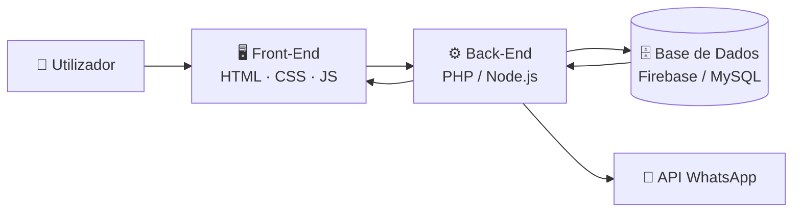

<div align="center">


<a href="https://github.com/telsioisidoro786-crypton">
  
</a>

<br/>


<br/>

**[🌐 Demo ao vivo]([https://seu-projeto.vercel.app](https://cftec.vercel.app/))** •
**[📖 Documentação](#-sobre-o-projeto)** •
**[🐞 Reportar Bug](https://github.com/telsioisidoro786-crypton/CFTEC/issues)** •
**[💡 Sugerir Melhoria](https://github.com/telsioisidoro786-crypton/NOME-DO-REPOSITORIO/issues)**

<br/>

> *"Nexora Systems."*

</div>

---

## 📑 Índice

- [📌 Sobre o Projeto](#-sobre-o-projeto)
- [🖼️ Pré-visualização](#️-pré-visualização)
- [🚀 Funcionalidades](#-funcionalidades-principais)
- [🏗️ Arquitetura](#️-arquitetura)
- [🛠️ Tecnologias](#️-tecnologias-utilizadas)
- [📦 Como Executar](#-como-executar-o-projeto-localmente)
- [⚙️ Variáveis de Ambiente](#️-variáveis-de-ambiente)
- [🗺️ Roadmap](#️-roadmap)
- [🤝 Contribuindo](#-contribuindo)
- [📄 Licença](#-licença)
- [👨‍💻 Autor](#-autor)

---

## 📌 Sobre o Projeto

**NOME DO PROJETO** é uma aplicação web criada para **jovens angolanos**, resolvendo **a falta de ligação entre eles** de forma simples, rápida e segura.

Em vez de processos manuais, planilhas soltas e comunicação desorganizada, o sistema centraliza tudo num único lugar, dando ao utilizador **controlo total**, **dados em tempo real** e uma experiência fluida em qualquer dispositivo.

### 🎯 Diferenciais

| | Diferencial | Impacto |
| :-: | :--- | :--- |
| ⚡ | **Performance** | Carregamento rápido, mesmo em ligações lentas |
| 🔒 | **Segurança** | Sessões protegidas e controlo de acesso por níveis |
| 📱 | **Mobile-first** | Pensado primeiro para telemóvel, depois para desktop |
| 🧩 | **Arquitetura modular** | Fácil de manter, escalar e integrar com outros serviços |

---

## 🖼️ Pré-visualização

<div align="center">

| Desktop | Mobile |
| :---: | :---: |
|  |  |

</div>

> 💡 **Dica:** substitui os placeholders por capturas reais guardadas em `/docs/screenshots/` ou por um GIF de demonstração.

---

## 🚀 Funcionalidades Principais

- 🔐 **Autenticação Segura:** controlo de acesso por níveis e sessões protegidas.
- 🗂️ **Painel Administrativo (CMS):** gestão dinâmica de conteúdos e dados em tempo real.
- 📱 **Interface Responsiva & Fluida:** design moderno adaptado a telemóveis e desktops.
- ⚙️ **Processamento de Dados:** validação e estruturação otimizada de requisições.
- 💬 **Integração com WhatsApp:** notificações e atendimento direto com o cliente *(opcional)*.
- 📊 **Relatórios & Métricas:** visão clara do desempenho do negócio.

<details>
<summary><b>➕ Ver funcionalidades em detalhe</b></summary>

<br/>

- **Níveis de acesso:** administrador, operador e visitante, cada um com permissões próprias.
- **Validação em duas camadas:** cliente (UX imediata) e servidor (segurança real).
- **Atualizações em tempo real:** alterações refletidas sem recarregar a página.

</details>

---

## 🏗️ Arquitetura



---

## 🛠️ Tecnologias Utilizadas

<div align="center">


</div>

| Camada | Tecnologia | Propósito |
| :--- | :--- | :--- |
| **Front-End** | JavaScript (ES6+), HTML5, CSS3, Bootstrap | Interface modular, componentes limpos e estilização responsiva. |
| **Back-End** | PHP / Node.js | Lógica de servidor, rotas e processamento de dados. |
| **Banco de Dados** | Firebase (Firestore) / MySQL | Armazenamento de dados e regras de segurança. |
| **Deploy** | Vercel / Netlify | Publicação contínua a cada `git push`. |

---

## 📦 Como Executar o Projeto Localmente

### ✅ Pré-requisitos

- 🟢 [Node.js](https://nodejs.org/) 18+ **ou** servidor local (XAMPP/WAMP) para PHP
- 🔀 [Git](https://git-scm.com/)
- 🌐 Navegador moderno (Brave, Chrome ou Firefox)

### 🧭 Passo a Passo

**1️⃣ Clone o repositório**

```bash
git clone https://github.com/telsioisidoro786-crypton/NOME-DO-REPOSITORIO.git
cd NOME-DO-REPOSITORIO
```

**2️⃣ Instale as dependências** *(se usar Node.js)*

```bash
npm install
```

**3️⃣ Configure as variáveis de ambiente**

```bash
cp .env.example .env
```

**4️⃣ Inicie o projeto**

```bash
# Node.js
npm run dev

# PHP (servidor embutido)
php -S localhost:8000
```

**5️⃣ Abra no navegador:** `http://localhost:3000` *(ou `:8000` para PHP)* 🎉

---

## ⚙️ Variáveis de Ambiente

| Variável | Descrição | Exemplo |
| :--- | :--- | :--- |
| `FIREBASE_API_KEY` | Chave pública do projeto Firebase | `AIza...` |
| `FIREBASE_PROJECT_ID` | ID do projeto | `meu-projeto` |
| `WHATSAPP_NUMBER` | Número para contacto direto | `244933609090` |

> ⚠️ **Nunca** envies o ficheiro `.env` para o GitHub. Mantém-no no `.gitignore`.

---

## 🗺️ Roadmap

- [x] Estrutura base e design responsivo
- [x] Autenticação e painel administrativo
- [ ] Integração completa com WhatsApp
- [ ] Modo escuro / claro
- [ ] Relatórios exportáveis em PDF
- [ ] Aplicação instalável (PWA)

---

## 🤝 Contribuindo

Contribuições são muito bem-vindas!

1. Faz um **fork** do projeto
2. Cria a tua branch: `git checkout -b feature/minha-feature`
3. Faz commit: `git commit -m "feat: adiciona minha feature"`
4. Envia: `git push origin feature/minha-feature`
5. Abre um **Pull Request** 🚀

---

## 📄 Licença

Distribuído sob a licença **MIT**. Consulta o ficheiro [`LICENSE`](LICENSE) para mais informações.

---

## 👨‍💻 Autor

<div align="center">

<a href="https://github.com/telsioisidoro786-crypton">
  
</a>

### **Telsio da Honda Isidoro**
*Fundador da Nexora Systems • Desenvolvedor Web*

[](https://github.com/telsioisidoro786-crypton)
[](https://wa.me/244922609090)
[](mailto:telsioisidoro786@gmail.com)

<br/>

⭐ **Se este projeto te ajudou, deixa uma estrela!** ⭐


</div>
